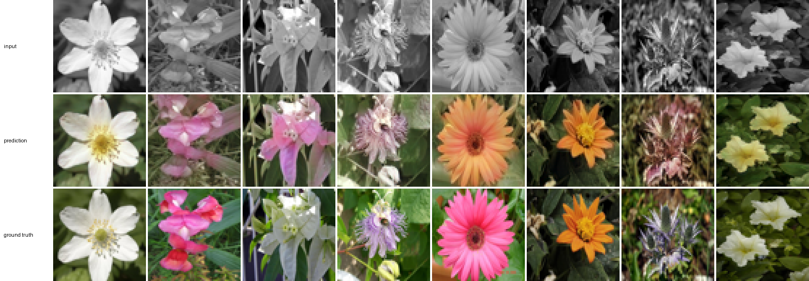

# UNet based image colorizer



## What is this?

It colors grayscale flower images using U-Net with self-attention. The model is trained on the [Oxford 102 Flower Dataset](https://paperswithcode.com/dataset/oxford-102-flower).

It works by converting the image from RGB to CIE Lab and training a U-Net that predicts the color channels (a, b) from the lightness channel (L).

The example above shows validation images (64x64): grayscale input, prediction, and ground truth.

## Usage

If you'd like to use vast.ai for training, a 24GB RTX4090 or RTX3090 instance is recommended.

Preparation:

```
$ pip install -r requirements.txt
$ wandb login
```

Optionally, save the dataset split to disk (Oxford 102 Flower does not have a train/val split; the split uses a pinned dataset revision and a fixed seed, and is made on the fly if this step is skipped):

```
$ python3 generate_split.py
```

Then run the training:

```
$ python3 train.py
```

Experiment configs in [configs/](configs/) select the color space (`lab` or the older `hsv`) and the attention variant, e.g. `python3 train.py --config configs/lab.yaml`. They are also what `scripts/pod_entry.sh` runs on a RunPod GPU, with results stored in Cloudflare R2 via `tools/r2.py`.

To compare checkpoints on the validation set:

```
$ python3 evaluate.py --out eval "lab=path/to/lab.ckpt" "hsv=path/to/hsv.ckpt"
```

[inference.ipynb](inference.ipynb) shows how to run the inference from a trained checkpoint.

## TODO

- [ ] Try loss function other than MSE
- [ ] Try datasets other than Oxford 102 Flower
- [ ] Try GAN or diffusion based approach

## License

MIT