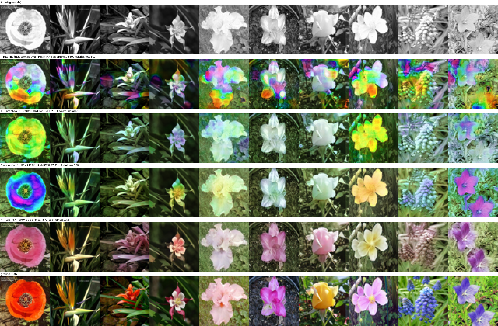

# UNet based image colorizer


## What is this?

It colors grayscale flower images using U-Net with self-attention. The model is trained on the [Oxford 102 Flower Dataset](https://paperswithcode.com/dataset/oxford-102-flower).

It works by converting the image from RGB to HSV, and training a U-Net predicting Hue and Saturation from Value.

## Usage

If you'd like to use vast.ai for training, a 24GB RTX4090 or RTX3090 instance is recommended.

Preparation:

```
$ pip install -r requirements.txt
$ wandb login
```

To generate the dataset split (Oxford 102 Flower does not have train/val split):

```
$ python3 generate_split.py
```

Then run the training:

```
$ python3 train.py
```

[inference.ipynb](inference.ipynb) shows how to run the inference from a trained checkpoint.

## Ablation (2026-11)

Same split (seed 0), 200 epochs each on one RTX 4090; evaluated one image at a time on the 819
validation images with `evaluate.py`. Lightning `val_loss` is in each model's own target space
(HSV vs Lab), so use the RGB/Lab columns to compare.

| step | RGB PSNR (dB) ↑ | ab RMSE ↓ | colorfulness (GT = 1.0) |
|---|---|---|---|
| 1. baseline as in the notebook (no `model.eval()`) | 14.45 | 34.0 | 1.07 (noise) |
| 2. + `model.eval()` | 16.46 | 29.8 | 0.70 |
| 3. + spatial self-attention fix (with residual) | 17.84 | 27.4 | 0.85 |
| 4. + Lab color space (predict ab from L) | 20.94 | 18.8 | 0.72 |



Reproduce: `configs/{baseline,attnfix,lab}.yaml` (RunPod via `scripts/pod_entry.sh`, artifacts in R2), then
`python3 evaluate.py --out eval "name=ckpt.pt[@train]" ...`.

## TODO

- [ ] Try loss function other than MSE
- [ ] Try datasets other than Oxford 102 Flower
- [ ] Try GAN or diffusion based approach

## License

MIT